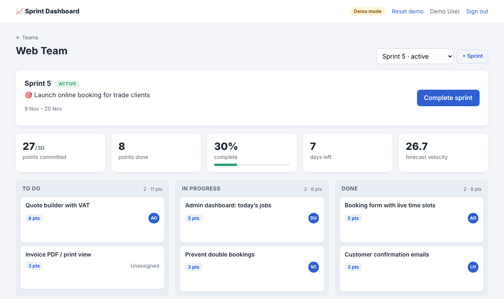
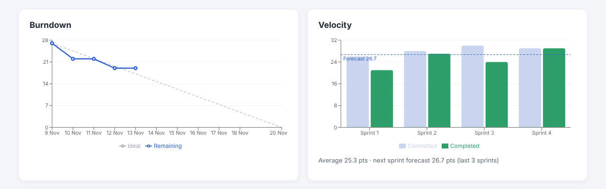

# Sprint Dashboard


A React + TypeScript front end for planning and running Scrum sprints. It has a drag-and-drop board, a backlog, capacity warnings, a live **burndown chart** and a **velocity forecast**.

It's the front end for my [Sprint Planner API](https://github.com/volaitan/sprint-planner-api) (FastAPI). It also has a **demo mode** that runs the same rules entirely in the browser, so it can be tried with no server.

**Live demo:** https://volaitan.github.io/sprint-dashboard/ (sign in with the pre-filled demo account)




## Features

- **Sign-in and registration** with JWT tokens. An expired session sends you back to the login screen automatically.
- **Teams and members:** create teams and add colleagues by email.
- **Sprint lifecycle:** plan → start → complete, with name, goal, dates and capacity.
- **Drag-and-drop board** (dnd-kit) with **optimistic updates**: cards move instantly and roll back if the server refuses. Arrow buttons give keyboard and touch users the same actions.
- **Backlog:** add stories with points and an assignee, pull them into a sprint, or send them back.
- **Capacity guard:** going over a sprint's capacity shows the API's message with an **"Add anyway"** button.
- **Burndown** (ideal vs actual) and **velocity** (committed vs completed, with a forecast line from the last three sprints), drawn with Recharts.
- **Accessible:** labelled controls, visible focus styles, live-region notifications and charts with text alternatives.
- **Code-split:** the charting and drag-and-drop code loads only when a team is opened.

## Two back ends, one interface

```ts
interface Api {
  login(email, password): Promise<void>;
  sprints(teamId): Promise<Sprint[]>;
  updateStory(id, changes, force?): Promise<Story>;
  burndown(sprintId): Promise<Burndown>;
  // …
}
```

- `HttpApi` calls sprint-planner-api over HTTP.
- `DemoApi` is an in-browser copy of the API with the same rules: one active sprint per team, capacity limits, unfinished work returns to the backlog when a sprint closes, and completion dates drive the burndown. It saves to `localStorage`.

The app uses `HttpApi` when `VITE_API_URL` is set, and `DemoApi` otherwise.

## Getting started

```bash
git clone https://github.com/volaitan/sprint-dashboard.git
cd sprint-dashboard
npm install
npm run dev                    # demo mode at http://localhost:5173
```

**Against the real API:**

```bash
# in sprint-planner-api
CORS_ORIGINS=http://localhost:5173 uvicorn app.main:app --reload

# in sprint-dashboard
VITE_API_URL=http://localhost:8000 npm run dev
```

| Script | |
|---|---|
| `npm run dev` | Development server |
| `npm test` | Vitest + Testing Library (18 tests) |
| `npm run typecheck` | Strict TypeScript |
| `npm run build` | Production build |

## Tests

- **Demo API rules:** capacity, a single active sprint, burndown maths, velocity after a sprint closes, and team privacy.
- **HTTP client:** the OAuth2 login form, bearer tokens, FastAPI error messages, `?force=true`, and automatic sign-out on 401.
- **UI flows:** signing in, wrong passwords, moving cards, the "Add anyway" override, adding stories and completing a sprint.

The UI was also tested end to end in a real browser against a running sprint-planner-api: register, create a team and sprint, add stories, start the sprint and move cards.

## Project structure

```
src/
├── api/           # types.ts (shared interface), http.ts, demo.ts (+ tests)
├── components/    # Board (dnd-kit), Charts (Recharts), Forms, Toast, Layout
├── pages/         # Login, Teams, Team (board, backlog, charts, members)
├── lib/           # Date helpers, story mutations with optimistic updates
└── App.tsx        # Routing (HashRouter for static hosting), React Query
```

## Deployment

GitHub Actions runs the type check, tests and build on every push. A second workflow publishes the demo build to **GitHub Pages**. To turn it on, go to the repo's Settings → Pages → Source and choose **GitHub Actions**.

## Licence

MIT
